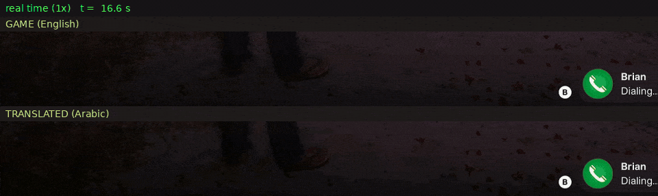
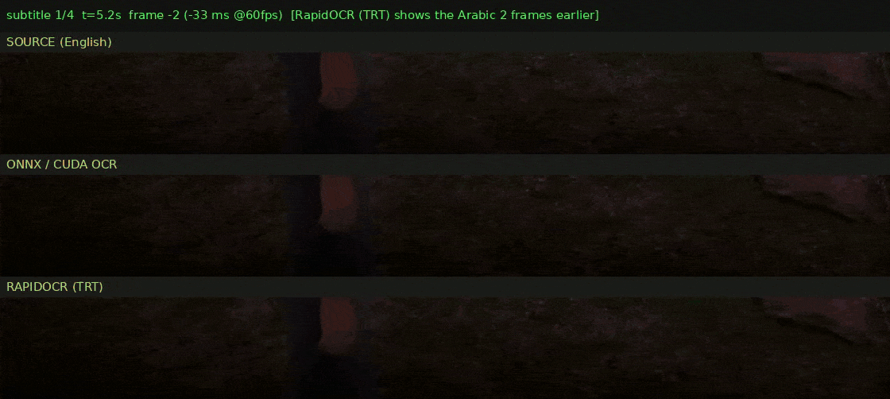
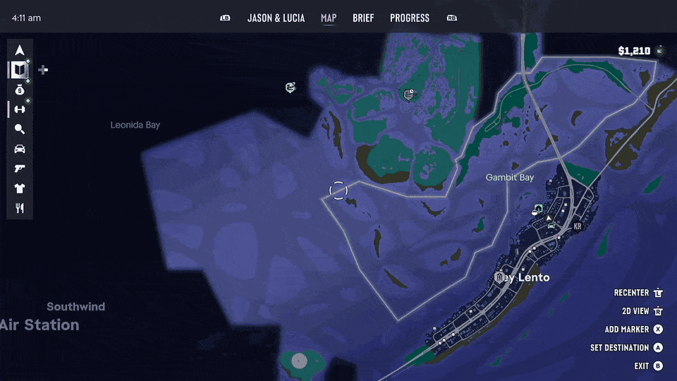

<h1 align="center">
  
translator-overlay

  

    
    
  

</h1>

Real-time English-to-Arabic subtitles (~50ms) for **GTA VI**. It reads the game picture from a capture card, a window or a video file, translates the subtitles and
draws the Arabic back over the picture. The game is never modified.

## Demo

The GPU used in this demo is `RTX 5070 12GB`.

- Subtitles translated in about ~65 ms.

- 6x slow motion to show the differences

- Map screen: labels and cards translated in place.

## Quick start

Needs Windows 10/11, an NVIDIA GPU (CUDA 13-capable driver), about 6 GB of free disk, [uv](https://docs.astral.sh/uv/) (`winget install --id=astral-sh.uv -e`; it also fetches Python 3.12), and a capture card.

1. **Set up** (once): `powershell -ExecutionPolicy Bypass -File tools\setup_windows.ps1`. It installs the environment and downloads the translation server and model.
2. **Point it at your capture card** (once): copy `config.capture.toml` to `config.local.toml` and set `device` under `[source]`
   (for example `cam:0:1920x1080@60:MJPG:msmf`; `.venv\Scripts\python.exe tools\list_cameras.py` lists your cards).
   For the game's sound through your speakers, also enable `[audio]` there.
3. **Run**: `powershell -ExecutionPolicy Bypass -File tools\windows_run.ps1 start`. A fullscreen window shows the game with the Arabic subtitles.
   Stop it with `q` in the window, or `tools\windows_run.ps1 stop`. The first start takes 30-60 s longer while the OCR engines are built for your GPU.

No capture card? Translate a video file: `python -m translator_overlay -c config.example.toml --source clip.mp4 --out out.mp4`

| Key | Action |
|---|---|
| `q` / `Esc` | quit |
| `f` | fullscreen / windowed |
| `r` | move and resize the subtitle box (drag, `WASD`, `Enter` saves) |
| `m` | map translation on / off |
| `a` | mute the capture-card sound |

## More

- [Advanced guide](docs/ADVANCED.md): how it works, conversations, recording, debug log, tools, other ways to install, another machine, limitations
- [All settings](config.example.toml) and the [changelog](CHANGELOG.md)

## Acknowledgements

- **[PLaMo-3 Translate](https://huggingface.co/collections/pfnet/plamo-3-translate)**: the translation model, created by Preferred Networks (PFN).
- **[RapidOCR](https://github.com/RapidAI/RapidOCR)**: the OCR engine that reads the subtitles, by RapidAI.
- **[vi-translator](https://github.com/vi-translator)**: the list of the game's speaker names with Arabic spellings comes from vi-translator-desktop (MIT License).
